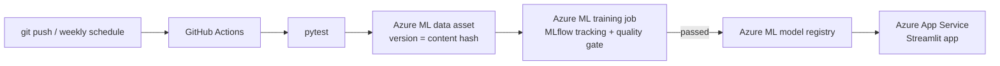

# 🦟 Dengue Early Warning for Sri Lankan Districts

A machine-learning early-warning model. **At the end of each report week it predicts whether a district will have a high-transmission dengue week two weeks later.**
It covers all 26 RDHS areas, uses 20 years of official Sri Lankan surveillance data, compares tuned tree ensembles, explains its predictions with SHAP and LIME, and is served through a Streamlit app.

> MSc in AI · Machine Learning assignment · R.M.K.D. Kumarasiri (269133N)
>
> **Submission files:** report [`reports/Report_269133N_KumarasiriRMKD.pdf`](reports/Report_269133N_KumarasiriRMKD.pdf) · notebook [`notebooks/dengue_early_warning.ipynb`](notebooks/dengue_early_warning.ipynb) · demo video script [`docs/demo_video_script.md`](docs/demo_video_script.md) · Azure MLOps guide [`docs/azure-mlops-guide.md`](docs/azure-mlops-guide.md)

## Results at a glance

Test set: **January 2024 – May 2026**, 3,145 district-weeks that were never used for training, tuning or model selection.

| Model | ROC-AUC | PR-AUC | F1 | Recall | Precision |
|---|---|---|---|---|---|
| **LightGBM (selected)** | **0.877** | **0.791** | **0.724** | **0.807** | 0.656 |
| Stacking (RF+XGB+LGBM+Cat → LR) | 0.888 | 0.816 | 0.743 | 0.850 | 0.660 |
| CatBoost | 0.887 | 0.813 | 0.737 | 0.783 | 0.696 |
| XGBoost | 0.882 | 0.803 | 0.735 | 0.817 | 0.667 |
| Random Forest | 0.882 | 0.805 | 0.731 | 0.826 | 0.655 |
| Logistic Regression | 0.875 | 0.787 | 0.705 | 0.718 | 0.693 |
| Persistence baseline (next = now) | 0.772 | 0.592 | 0.700 | 0.706 | 0.695 |
| Seasonal naive (same week last year) | 0.585 | 0.394 | 0.472 | 0.506 | 0.442 |

* The model was **selected by cross-validation, before looking at the test set**. LightGBM had the best time-series CV PR-AUC, and the stacking ensemble didn't beat it by the pre-set 0.005 margin. On test, all the tuned tree models fall within each other's 95% bootstrap intervals, and all of them clearly beat the persistence baseline (LightGBM PR-AUC 0.753–0.827 vs 0.547–0.635).
* Tuning improved CV PR-AUC for every model (+0.001 for logistic regression; +0.009 to +0.033 for the tree models, most for XGBoost).
* **Most important drivers (SHAP):** this week's level vs threshold, the 4-week average vs threshold, the share of districts nationally above threshold, last week's level, national 4-week growth and the seasonal norm. LIME picks the same four core features on the hold-out point, consistently across 5 seeds.
* **Hold-out point:** Colombo, week of 27 Apr 2026 (300 cases). Predicted P = 0.63, so HIGH RISK. The actual count two weeks later was 308 against a threshold of 291, so HIGH RISK ✔.

<p float="left">


</p>


## Problem

Dengue is endemic in Sri Lanka. In this dataset, 174,687 cases were reported in 2017 (the worst epidemic year) and 70,918 in 2023.
MOH offices and PHIs respond to rising cases with vector control (fogging, larval source reduction and clean-up drives), and these campaigns need **lead time**.
This project gives each district a **probability of a high-transmission week two weeks ahead**. One week covers the reporting delay and one week covers mobilisation.

* **Task:** binary classification.
* **Target:** `high_risk = 1` if cases in week *t + 2* exceed the district's **75th percentile of weekly cases over 2012–2021**. Each district is judged on its own scale, so 150 cases a week is normal for Colombo while 15 is high for Mullaitivu.

## Data (local, real)

| | |
|---|---|
| Source | **Epidemiology Unit, Ministry of Health Sri Lanka** – Weekly Epidemiological Report (dengue notifications by RDHS area) |
| Access | Tidy version in the `denguedatahub` R package by Dr. Thiyanga S. Talagala (University of Sri Jayewardenepura), [github.com/thiyangt/denguedatahub](https://github.com/thiyangt/denguedatahub), object `srilanka_weekly_data`, exported to `data/raw/srilanka_weekly_dengue.csv` |
| Size | 26,311 rows: 26 RDHS areas × weekly, 23 Dec 2006 → 17 May 2026 |
| Columns | `year, week, start.date, end.date, district, cases` |

## Method

1. **EDA:** trends, the 2017/2019/2023 epidemics, district × year heatmap, monsoon seasonality, skew, autocorrelation, class balance over time.
2. **Data quality:** one missing week (Puttalam) is filled by within-district interpolation. **Monaragala 2020 is recorded as 52 weeks of zeros**, between 330 cases in 2019 and 192 in 2021. That is a reporting failure, so the year is set to missing and the 106 district-weeks that depend on it are excluded. A rule for isolated implausible weeks (below 10% or above 10× both neighbouring weeks) catches **22 more values**: missed reports recorded as 0, and the week of 30 Mar 2026, when counts were shifted between districts (Colombo 9, Kilinochchi 117). These are imputed.
3. **Features (19):** all known at week *t*. They are log ratios of recent counts and moving averages to the district threshold, growth rates, 8-week volatility, last year's level in the target week, a seasonal norm, sine/cosine of the target week, national growth, the share of districts above threshold, and the district's baseline burden.
4. **Split:** chronological and purged. Train 2007–2021 | validation 2022–2023 | **test Jan 2024 – May 2026**, plus **one hold-out data point** used only for the inference demo.
5. **Models:** persistence and seasonal-naive baselines, Logistic Regression, **Random Forest, XGBoost**, LightGBM, CatBoost, and a **time-series stacking ensemble**.
6. **Tuning:** Optuna TPE search on every model, scored by mean PR-AUC over 5 expanding-window CV folds (validation years 2019–2023). Default hyperparameters are shown only for comparison.
7. **Evaluation:** ROC-AUC, PR-AUC, F1, precision, recall, balanced accuracy, Brier score and week-block bootstrap confidence intervals. Also calibration, per-district results and forecast timelines.
8. **Explainability:** SHAP (beeswarm, bar, dependence, waterfall) and LIME (hold-out point, a correctly forecast onset, a missed outbreak, a seed-stability check), plus a SHAP-vs-LIME agreement check.
9. **Inference and app:** the model is saved with `joblib` (pickle) and reloaded to predict the hold-out point. The Streamlit app predicts all districts for any week, supports what-if edits and shows a per-prediction SHAP explanation.

## Repository layout

```
├── app/app.py                      Streamlit front-end
├── data/
│   ├── raw/                        original data (.rda + exported .csv)
│   ├── processed/                  cleaned weekly grid used by the app
│   └── holdout_sample.csv          the single held-out data point
├── models/
│   ├── dengue_model.pkl            saved model bundle (model + threshold + reference stats)
│   ├── best_params.json            tuned hyperparameters for every model
│   ├── model_metadata.json         model card (metrics, threshold, training window)
│   └── registry/                   one JSON per retrained version (MLOps)
├── notebooks/
│   ├── dengue_early_warning.ipynb  full analysis, executed with outputs
│   └── dengue_early_warning.py     same notebook as a plain script (jupytext)
├── reports/figures/                all plots
├── src/
│   ├── features.py                 cleaning, data-quality rule, features, purged split, CV folds
│   ├── models.py                   model factory, persistence baseline, TimeSeriesStack
│   ├── validate.py                 data validation gate
│   ├── train.py                    reproducible training pipeline + quality gate + MLflow
│   ├── fetch_data.py               pulls the latest weekly data
│   └── inference.py                shared inference used by app and tests
├── tests/test_pipeline.py          leakage, split, validation and model/app consistency tests
├── azure/                          Azure ML job, environment, data asset and compute definitions
├── docs/azure-mlops-guide.md       step-by-step Azure + GitHub MLOps setup
├── scripts/setup_azure.sh         one-command Azure + GitHub secrets setup
├── .github/workflows/              ci.yml (tests) + azure-mlops.yml (train → register → deploy)
├── Dockerfile
└── requirements.txt / requirements-dev.txt
```

## Run it

```bash
pip install -r requirements-dev.txt
jupyter notebook notebooks/dengue_early_warning.ipynb   # full analysis
streamlit run app/app.py                                # the app
pytest -q                                               # tests
python -m src.train                                     # retrain + quality gate + MLflow log
mlflow ui --backend-store-uri sqlite:///mlflow.db                    # browse experiment runs
```

Docker: `docker build -t dengue-ew . && docker run -p 8501:8501 dengue-ew`

## MLOps on Azure (bonus)

**Setup guide:** [`docs/azure-mlops-guide.md`](docs/azure-mlops-guide.md) · **Live app:** `https://<your-webapp>.azurewebsites.net`



| Practice | Implementation |
|---|---|
| Source control + CI | GitHub. `ci.yml` runs `pytest` (no future leakage, purged split, data validation, app reproduces training features) on every push and PR |
| Data versioning | `azure/data-asset.yml`: Azure ML data asset `dengue-weekly`, version = SHA-256 of the file |
| Reproducible environment | `azure/environment.yml` + `azure/conda.yml`: pinned Python 3.12 environment, versioned by hash |
| Cloud training | `azure/train-job.yml`: Azure ML command job on `cpu-cluster` (scales to zero) running `src/train.py` |
| Experiment tracking | MLflow in the Azure ML workspace: parameters, test metrics, baseline metrics, data report, model file |
| Quality gate | The job fails, and nothing is registered or deployed, unless the model beats the persistence baseline on PR-AUC and F1 |
| Model registry | Azure ML model `dengue-ews-lightgbm`, one version per passing run, tagged with git commit and job |
| Continuous deployment | `azure-mlops.yml` downloads the latest registered model and deploys the Streamlit app to Azure App Service |
| Continuous training | Weekly schedule fetches new Epidemiology Unit data, then retrains, gates, registers and redeploys |
| Secure auth | GitHub → Azure via OIDC with a managed identity; no stored passwords |
| Local equivalent | `python -m src.train` logs to a local MLflow SQLite store; `Dockerfile` for container serving |

## Assignment requirement checklist

| # | Requirement | Type | Status | How it's met |
|---|---|---|---|---|
| 1 | Identify a meaningful real-world ML problem | Required | ✅ | District-level dengue early warning: flag high-transmission weeks 2 weeks ahead so MOH/PHI teams can plan vector control (notebook §1) |
| 2 | Use a real, locally relevant dataset | Required | ✅ | Epidemiology Unit (Ministry of Health Sri Lanka) weekly dengue notifications, 26 RDHS areas, 2006–2026, 26,311 rows (§2) |
| 3 | Classification or regression | Allowed | ✅ | Binary classification: `high_risk` = cases in week t+2 above the district's 75th percentile |
| 4 | Perform proper exploratory data analysis | Required | ✅ | National trend, annual totals, district totals, district × year heatmap, monsoon seasonality, skew, autocorrelation, feature correlations, class balance over time (§5). The EDA uncovered the data-quality problems |
| 5 | Perform data preprocessing | Required | ✅ | Complete time grid; interpolation of a missing week; Monaragala 2020 year of zeros treated as missing and excluded; 22 implausible or misaligned values detected and imputed; outlier analysis; log1p transform; threshold-relative features; StandardScaler in a pipeline for LR; purged chronological split (§6) |
| 6 | Select suitable ML algorithms | Required | ✅ | Tree ensembles for non-linear, interacting, collinear lag features, plus a regularised LR and two naive baselines for reference (§7–8) |
| 7 | Train and compare multiple ML models | Required | ✅ | Random Forest, XGBoost, LightGBM, CatBoost, Logistic Regression, time-series stacking ensemble, persistence and seasonal-naive baselines (§8–11) |
| 8 | Perform hyperparameter tuning | Required | ✅ | Optuna TPE search (15–30 trials per model) with model-specific search spaces, scored by 5-fold expanding-window time-series CV. Default vs tuned comparison, search history and hyperparameter importance (§9) |
| 9 | Evaluate model performance | Required | ✅ | ROC-AUC, PR-AUC, F1, precision, recall, balanced accuracy, Brier score; week-block bootstrap 95% CIs; ROC and PR curves; confusion matrix; calibration; per-district results; forecast timelines (§11) |
| 10 | Explain why the selected model is suitable | Required | ✅ | Pre-registered CV selection rule, comparison against baselines and alternatives, and an honest discussion of calibration and the test-set ranking (§11.1) |
| 11 | Apply SHAP for explainability | Required | ✅ | TreeSHAP beeswarm, bar, dependence plots and hold-out waterfall (§12.1). A per-prediction SHAP waterfall is shown in the app |
| 12 | Apply LIME for explainability | Required | ✅ | LIME for the hold-out point, a correctly forecast onset and a missed outbreak; a 5-seed stability check; SHAP-vs-LIME sign agreement (§12.2) |
| 13 | Interpret and explain model predictions | Required | ✅ | Global and local interpretation in epidemiological terms (§12.3) |
| 14 | Build a small working ML application | Required | ✅ | Streamlit app `app/app.py` with national overview, district forecast and what-if, hold-out check and model performance tabs |
| 15 | Accept user input and perform inference | Required | ✅ | User picks a week and district and can edit recent weekly counts; the app recomputes features and predicts live |
| 16 | Save and reuse the trained model | Expected | ✅ | `models/dengue_model.pkl` (joblib/pickle bundle), reloaded to predict the held-out data point (§13) and by the app |
| 17 | Use AI coding assistants | Permitted | ✅ | Used to help write code and the app (declare as your module requires) |
| 18 | Understand and justify your own ML work | Required | ✅ | Every design decision is justified in the notebook: target, leakage control, metrics, tuning spaces, selection rule, limitations |
| 19 | Implement MLOps | Optional (bonus) | ✅ | Azure ML: versioned data asset and environment, cloud training job, MLflow tracking, quality gate, model registry. GitHub Actions CI/CD/CT with OIDC; app auto-deployed to Azure App Service ([guide](docs/azure-mlops-guide.md)) |
| 20 | GitHub repository + deployment | Bonus | ⏳ | Repo-ready with workflows. Follow the [guide](docs/azure-mlops-guide.md) to push to GitHub and deploy on Azure, then add the live URL above |
| 21 | Avoid deep learning, CV and RL | Restriction | ✅ | Only classical ML (tree ensembles, logistic regression) |
| 22 | Use a new problem | Required | ✅ | Dengue outbreak early warning, not the commonly used car or house price datasets |


## Limitations

* **No weather inputs.** District rainfall and temperature are known dengue drivers. They weren't available as an open district-weekly series, so seasonality and national momentum stand in for them. Adding Department of Meteorology rainfall is the clearest next step.
* **Reported cases, not infections.** Changes in testing and reporting (COVID-19 in 2020–21, the Monaragala 2020 gap) affect the labels.
* **Thresholds are fixed** at the 2012–2021 75th percentile. If the baseline keeps rising, they should be re-estimated periodically, which the weekly Azure retraining makes easy.
* **Uneven performance:** F1 0.90 in Gampaha but 0.22–0.48 in Vavuniya, Kurunegala, Mullaitivu and Kilinochchi, where high weeks are rare. Used naively, it would give weaker warnings to areas with fewer resources. District-specific alert thresholds and human review are recommended.
* **Ethics:** aggregate public data only, with no personal information. This is decision support with a human in the loop. It's for research and education, not an official alert system.
