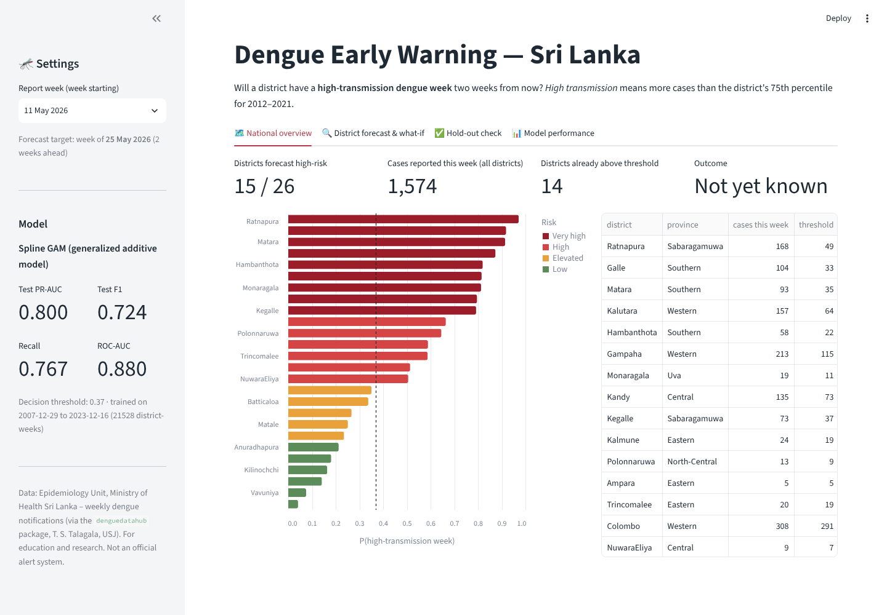
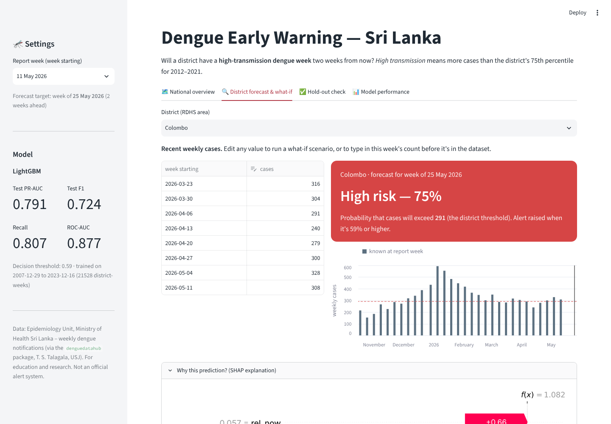
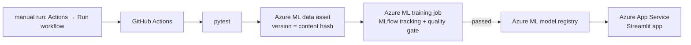

# 🦟 Dengue Early Warning for Sri Lankan Districts

A machine-learning early-warning model. **At the end of each report week it predicts whether a district will have a high-transmission dengue week two weeks later.**
It covers all 26 RDHS areas and uses 20 years of official Sri Lankan surveillance data. The model is an **Explainable Boosting Machine (EBM)**, an interpretable algorithm not covered in the module's lectures. It's compared with five standard models, explained with its own glass-box terms plus SHAP and LIME, and served through a Streamlit app.

> MSc in AI · Machine Learning assignment · R.M.K.D. Kumarasiri (269133N)
>
> **Files:** notebook [`notebooks/dengue_early_warning.ipynb`](notebooks/dengue_early_warning.ipynb) (HTML copy: [`notebooks/dengue_early_warning.html`](notebooks/dengue_early_warning.html)) · Azure MLOps guide [`docs/azure-mlops-guide.md`](docs/azure-mlops-guide.md)

## Results at a glance

Test set: **January 2024 – May 2026**, 3,145 district-weeks that were never used for training, tuning or model selection.

| Model | ROC-AUC | PR-AUC | F1 | Recall | Precision |
|---|---|---|---|---|---|
| **EBM (new algorithm)** | **0.867** | **0.777** | **0.715** | **0.801** | 0.645 |
| Random Forest (standard) | 0.883 | 0.806 | 0.730 | 0.793 | 0.676 |
| k-NN (standard) | 0.881 | 0.805 | 0.730 | 0.864 | 0.631 |
| XGBoost (standard) | 0.883 | 0.805 | 0.732 | 0.826 | 0.657 |
| Logistic Regression (standard) | 0.875 | 0.785 | 0.720 | 0.774 | 0.673 |
| Decision Tree (standard) | 0.862 | 0.771 | 0.704 | 0.793 | 0.632 |
| Persistence baseline (next = now) | 0.772 | 0.592 | 0.700 | 0.706 | 0.695 |
| Seasonal naive (same week last year) | 0.585 | 0.394 | 0.472 | 0.506 | 0.442 |

* **The new algorithm:** an Explainable Boosting Machine (InterpretML, Microsoft Research). It's a generalized additive model with pairwise interactions: one learned curve per feature plus a few two-feature terms, so every prediction is an **exact sum of readable contributions**. The lecture models (logistic regression, decision tree, k-NN, Random Forest, XGBoost) are used **only as comparisons**, to show how EBM differs.
* **In cross-validation, EBM is level with the best black box** (PR-AUC 0.786 vs XGBoost 0.787). On the more epidemic test period it trails Random Forest, XGBoost and k-NN by about 0.03 PR-AUC. That's the measured cost of full interpretability, accepted for a public-health alert that officials must be able to audit.
* **Against the persistence baseline**, PR-AUC rises from 0.59 to 0.78 and recall from 71% to 80%.
* **What it learned:** the recent level vs the district threshold (4-week average, this week, last week), the share of districts already high, national growth and season. It also learned an interaction: above-threshold weeks matter most in high-burden districts. SHAP agrees with EBM's own importance (Spearman 0.97), and LIME picks the same core features.
* **Hold-out point:** Colombo, week of 27 Apr 2026 (300 cases). Predicted P = 0.32, above the 0.31 threshold, so HIGH RISK. The actual count two weeks later was 308 against a threshold of 291 ✔.

<p float="left">


</p>

**Could anything do better?** Eight more algorithms that were not covered in lectures and aren't deep learning were scored with the same expanding-window CV. The model was chosen by CV; test PR-AUC is listed for reference only (`python -m scripts.other_algorithms`, results in `reports/other_algorithms.csv`; report §3.4, notebook §12.2).

| Algorithm | CV PR-AUC | Test PR-AUC | Interpretable |
|---|---|---|---|
| Stacking (EBM+LR+kNN+RF+XGB → LR) | 0.789 | 0.804 | no; built from lecture models |
| **EBM (chosen)** | **0.786** | **0.777** | **exactly** |
| NGBoost | 0.785 | 0.795 | no; gradient-boosting variant |
| RuleFit | 0.783 | 0.796 | yes |
| Extra Trees | 0.782 | 0.805 | no; Random Forest variant |
| Spline GAM (pyGAM) | 0.782 | 0.794 | yes |
| Gaussian Naive Bayes / LDA / QDA | 0.756 / 0.729 / 0.677 | 0.758 / 0.714 / 0.711 | partly |

Seven EBM refinements were also scored by CV (`python -m scripts.ebm_cv_experiments`, results in `reports/ebm_cv_ablation.csv`): more interactions, finer bins, a slower learning rate, recency weighting and monotone constraints. They ranged from 0.782 to 0.788 CV PR-AUC, all within ±0.005 of the tuned model, so the tuned EBM was kept.


## Problem

Dengue is endemic in Sri Lanka. In this dataset, 174,687 cases were reported in 2017 (the worst epidemic year) and 70,918 in 2023.
MOH offices and PHIs respond to rising cases with vector control (fogging, larval source reduction and clean-up drives), and these campaigns need **lead time**.
This project gives each district a **probability of a high-transmission week two weeks ahead**. One week covers the reporting delay and one week covers mobilisation.

* **Task:** binary classification.
* **Target:** `high_risk = 1` if cases in week *t + 2* exceed the district's **75th percentile of weekly cases over 2012–2021**. Each district is judged on its own scale, so 150 cases a week is normal for Colombo while 15 is high for Mullaitivu.

## Data (local, real)

| | |
|---|---|
| Source | **Epidemiology Unit, Ministry of Health Sri Lanka** – Weekly Epidemiological Report (dengue notifications by RDHS area) |
| Access | Tidy version in the `denguedatahub` R package by Dr. Thiyanga S. Talagala (University of Sri Jayewardenepura), [github.com/thiyangt/denguedatahub](https://github.com/thiyangt/denguedatahub), object `srilanka_weekly_data`, exported to `data/raw/srilanka_weekly_dengue.csv` |
| Size | 26,311 rows: 26 RDHS areas × weekly, 23 Dec 2006 → 17 May 2026 |
| Columns | `year, week, start.date, end.date, district, cases` |

## Method

1. **EDA:** trends, the 2017/2019/2023 epidemics, district × year heatmap, monsoon seasonality, skew, autocorrelation, class balance over time.
2. **Data quality:** one missing week (Puttalam) is filled by within-district interpolation. **Monaragala 2020 is recorded as 52 weeks of zeros**, between 330 cases in 2019 and 192 in 2021. That is a reporting failure, so the year is set to missing and the 106 district-weeks that depend on it are excluded. A rule for isolated implausible weeks (below 10% or above 10× both neighbouring weeks) catches **22 more values**: missed reports recorded as 0, and the week of 30 Mar 2026, when counts were shifted between districts (Colombo 9, Kilinochchi 117). These are imputed.
3. **Features (19):** all known at week *t*. They are log ratios of recent counts and moving averages to the district threshold, growth rates, 8-week volatility, last year's level in the target week, a seasonal norm, sine/cosine of the target week, national growth, the share of districts above threshold, and the district's baseline burden.
4. **Split:** chronological and purged. Train 2007–2021 | validation 2022–2023 | **test Jan 2024 – May 2026**, plus **one hold-out data point** used only for the inference demo.
5. **Models:** the **new algorithm, EBM**, compared with five standard models (Logistic Regression, Decision Tree, k-NN, Random Forest, XGBoost) and two naive baselines (persistence, seasonal naive).
6. **Tuning:** Optuna TPE search on every model (20 trials for EBM: learning rate, bins, leaves, interactions, smoothing), scored by mean PR-AUC over 5 expanding-window CV folds (validation years 2019–2023). Default hyperparameters are shown only for comparison.
7. **Evaluation:** ROC-AUC, PR-AUC, F1, precision, recall, balanced accuracy, Brier score and week-block bootstrap confidence intervals. Also calibration, per-district results and forecast timelines.
8. **Explainability:** EBM's glass-box explanations (global term importance, shape functions as exact partial dependence, interaction heat map, exact local contributions), SHAP (permutation explainer: beeswarm, dependence, waterfall) and LIME (hold-out point, a correct early warning, a missed outbreak, a seed-stability check), plus a three-way agreement check.
9. **Inference and app:** the model is saved with `joblib` (pickle) and reloaded to predict the hold-out point. The Streamlit app predicts all districts for any week, supports what-if edits and shows the exact EBM explanation of each prediction.

## Repository layout

```
├── app/app.py                      Streamlit front-end
├── data/
│   ├── raw/                        original data (.rda + exported .csv)
│   ├── processed/                  cleaned weekly grid used by the app
│   └── holdout_sample.csv          the single held-out data point
├── models/
│   ├── dengue_model.pkl            saved model bundle (model + threshold + reference stats)
│   ├── best_params.json            tuned hyperparameters for every model
│   ├── model_metadata.json         model card (metrics, threshold, training window)
│   └── registry/                   one JSON per retrained version (MLOps)
├── notebooks/
│   ├── dengue_early_warning.ipynb  full analysis, executed with outputs
│   └── dengue_early_warning.py     same notebook as a plain script (jupytext)
├── reports/figures/                all plots
├── src/
│   ├── features.py                 cleaning, data-quality rule, features, purged split, CV folds
│   ├── models.py                   model factory, persistence baseline, TimeSeriesStack
│   ├── validate.py                 data validation gate
│   ├── train.py                    reproducible training pipeline + quality gate + MLflow
│   ├── fetch_data.py               pulls the latest weekly data
│   └── inference.py                shared inference used by app and tests
├── tests/test_pipeline.py          leakage, split, validation and model/app consistency tests
├── azure/                          Azure ML job, environment, data asset and compute definitions
├── docs/azure-mlops-guide.md       step-by-step Azure + GitHub MLOps setup
├── scripts/setup_azure.sh         one-command Azure + GitHub secrets setup
├── .github/workflows/              ci.yml (tests) + azure-mlops.yml (train → register → deploy)
├── Dockerfile
└── requirements.txt / requirements-dev.txt
```

## Run it

```bash
pip install -r requirements-dev.txt
jupyter notebook notebooks/dengue_early_warning.ipynb   # full analysis
streamlit run app/app.py                                # the app
pytest -q                                               # tests
python -m src.train                                     # retrain + quality gate + MLflow log
mlflow ui --backend-store-uri sqlite:///mlflow.db                    # browse experiment runs
```

Docker: `docker build -t dengue-ew . && docker run -p 8501:8501 dengue-ew`

## MLOps on Azure (bonus)

**Setup guide:** [`docs/azure-mlops-guide.md`](docs/azure-mlops-guide.md) · **Live app:** https://dengue-ews-kumarasiri.azurewebsites.net



| Practice | Implementation |
|---|---|
| Source control + CI | GitHub. `ci.yml` runs `pytest` (no future leakage, purged split, data validation, app reproduces training features) on every push and PR |
| Data versioning | `azure/data-asset.yml`: Azure ML data asset `dengue-weekly`, version = SHA-256 of the file |
| Reproducible environment | `azure/environment.yml` + `azure/job-requirements.txt`: public Python 3.12 image plus pinned packages, versioned by hash |
| Cloud training | `azure/train-job.yml`: Azure ML command job on `cpu-cluster` (scales to zero) running `src/train.py` |
| Experiment tracking | MLflow in the Azure ML workspace: parameters, test metrics, baseline metrics, data report, model file |
| Quality gate | The job fails, and nothing is registered or deployed, unless the model beats the persistence baseline on PR-AUC and F1 |
| Model registry | Azure ML model `dengue-ews-ebm`, one version per passing run, tagged with git commit and job |
| Continuous deployment | `azure-mlops.yml` downloads the latest registered model and deploys the Streamlit app to Azure App Service |
| Retraining on demand | Started by hand (Actions → Azure MLOps → Run workflow). It fetches nothing automatically and has no schedule, to protect the student credit |
| Secure auth | GitHub → Azure via OIDC with a managed identity; no stored passwords |
| Local equivalent | `python -m src.train` logs to a local MLflow SQLite store; `Dockerfile` for container serving |

## Assignment requirement checklist

| # | Requirement | Type | Status | How it's met |
|---|---|---|---|---|
| 1 | Identify a meaningful real-world ML problem | Required | ✅ | District-level dengue early warning: flag high-transmission weeks 2 weeks ahead so MOH/PHI teams can plan vector control (notebook §1) |
| 2 | Use a real, locally relevant dataset | Required | ✅ | Epidemiology Unit (Ministry of Health Sri Lanka) weekly dengue notifications, 26 RDHS areas, 2006–2026, 26,311 rows (§2) |
| 3 | Classification or regression | Allowed | ✅ | Binary classification: `high_risk` = cases in week t+2 above the district's 75th percentile |
| 4 | Perform proper exploratory data analysis | Required | ✅ | National trend, annual totals, district totals, district × year heatmap, monsoon seasonality, skew, autocorrelation, feature correlations, class balance over time (§5). The EDA uncovered the data-quality problems |
| 5 | Perform data preprocessing | Required | ✅ | Complete time grid; interpolation of a missing week; Monaragala 2020 year of zeros treated as missing and excluded; 22 implausible or misaligned values detected and imputed; outlier analysis; log1p transform; threshold-relative features; StandardScaler in a pipeline for LR; purged chronological split (§6) |
| 6 | Select suitable ML algorithms | Required | ✅ | **New algorithm: Explainable Boosting Machine (not covered in lectures)**: an interpretable GA²M for non-linear, interacting, collinear features. How it differs from LR, DT, k-NN and RF/XGBoost is explained in §8 |
| 7 | Train and compare multiple ML models | Required | ✅ | EBM vs Logistic Regression, Decision Tree, k-NN, Random Forest, XGBoost (standard models used only as comparisons) plus persistence and seasonal-naive baselines (§9–12) |
| 8 | Perform hyperparameter tuning | Required | ✅ | Optuna TPE search (20 trials for EBM, 10–20 for each comparison model), scored by 5-fold expanding-window time-series CV. Default vs tuned, search history and EBM hyperparameter importance (§10) |
| 9 | Evaluate model performance | Required | ✅ | ROC-AUC, PR-AUC, F1, precision, recall, balanced accuracy, Brier score; week-block bootstrap 95% CIs; ROC and PR curves; confusion matrix; calibration; per-district results; forecast timelines (§12) |
| 10 | Explain why the selected model is suitable | Required | ✅ | EBM matches the best black box in CV, beats persistence clearly and explains every prediction exactly. The ~0.03 test PR-AUC cost of interpretability is reported openly (§8, §12.1) |
| 11 | Apply SHAP for explainability | Required | ✅ | Permutation SHAP on the EBM: beeswarm, dependence, hold-out waterfall, and agreement with EBM's own importance (Spearman 0.97) (§13.2) |
| 12 | Apply LIME for explainability | Required | ✅ | LIME for the hold-out point, a correct early warning and a missed outbreak; a 5-seed stability check; EBM–SHAP–LIME agreement (§13.3) |
| 13 | Interpret and explain model predictions | Required | ✅ | EBM shape functions, interaction heat map and exact local contributions, interpreted in epidemiological terms (§13.1, §13.4). The app shows the exact explanation of every prediction |
| 14 | Build a small working ML application | Required | ✅ | Streamlit app `app/app.py` with national overview, district forecast and what-if, hold-out check and model performance tabs |
| 15 | Accept user input and perform inference | Required | ✅ | User picks a week and district and can edit recent weekly counts; the app recomputes features and predicts live |
| 16 | Save and reuse the trained model | Expected | ✅ | `models/dengue_model.pkl` (joblib/pickle bundle), reloaded to predict the held-out data point (§14) and by the app |
| 17 | Use AI coding assistants | Permitted | ✅ | Used to help write code and the app (declare as your module requires) |
| 18 | Understand and justify your own ML work | Required | ✅ | Every design decision is justified in the notebook: target, leakage control, metrics, tuning spaces, selection rule, limitations |
| 19 | Implement MLOps | Optional (bonus) | ✅ | Azure ML: versioned data asset and environment, cloud training job, MLflow tracking, quality gate, model registry. GitHub Actions CI/CD with OIDC (Azure runs on demand only, to protect the student credit); app auto-deployed to Azure App Service ([guide](docs/azure-mlops-guide.md)) |
| 20 | GitHub repository + deployment | Bonus | ✅ | Code on GitHub with CI. The Azure MLOps pipeline trained the EBM in Azure ML, registered it in the model registry and deployed the app to Azure App Service: https://dengue-ews-kumarasiri.azurewebsites.net |
| 21 | Avoid deep learning, CV and RL | Restriction | ✅ | No deep learning: EBM is a boosted additive model. Comparisons are classical ML only |
| 22 | Use a new problem | Required | ✅ | Dengue outbreak early warning, not the commonly used car or house price datasets |
| 23 | Use an algorithm not taught in lectures | Required | ✅ | Explainable Boosting Machine. Lecture models (LR, DT, k-NN, RF, XGBoost) appear only as comparisons |


## Limitations

* **No weather inputs.** District rainfall and temperature are known dengue drivers. They weren't available as an open district-weekly series, so seasonality and national momentum stand in for them. Adding Department of Meteorology rainfall is the clearest next step.
* **Reported cases, not infections.** Changes in testing and reporting (COVID-19 in 2020–21, the Monaragala 2020 gap) affect the labels.
* **Thresholds are fixed** at the 2012–2021 75th percentile. If the baseline keeps rising, they should be re-estimated periodically, which the on-demand Azure retraining makes easy.
* **Accuracy cost of interpretability:** about 0.03 PR-AUC below the best black boxes on the test period.
* **Uneven performance:** F1 0.88 in Gampaha but 0.20–0.47 in Vavuniya, Mullaitivu, Kilinochchi and Badulla, where high weeks are rare. Used naively, it would give weaker warnings to areas with fewer resources. District-specific alert thresholds and human review are recommended.
* **Ethics:** aggregate public data only, with no personal information. This is decision support with a human in the loop. It's for research and education, not an official alert system.
