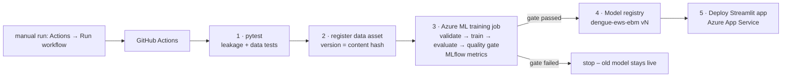

# MLOps on Azure + GitHub: step-by-step guide

This guide takes the project from your laptop to a full MLOps setup:

* **GitHub** holds the code and runs **GitHub Actions** (CI/CD).
* **Azure Machine Learning** stores versioned **data**, **environments** and **models**, runs the **training job** on a cloud compute cluster, and tracks every run with **MLflow**.
* **Azure App Service** hosts the Streamlit app and is redeployed automatically with each newly registered model.
* GitHub logs in to Azure with **OIDC through a managed identity**, so no passwords or keys are stored anywhere.



> **Quick path:** after step 0 (`az login`, `gh auth login`), run **`bash scripts/setup_azure.sh`** from the project folder.
> It does steps 2–4 for this repository: it creates all the Azure resources and the GitHub login, and sets the GitHub secrets and variables.
> Then start the workflow (step 5). The manual steps below explain what the script does.

You'll run commands in **Terminal on your Mac**. Lines in `<angle brackets>` are values you replace.
Allow about **1–1.5 hours** the first time, most of it waiting for Azure to build things.

---

## 0. Accounts and tools (once)

1. **Azure for Students:** sign up at <https://azure.microsoft.com/free/students> with your university email. You get US$100 of credit for 12 months, and no credit card is needed.
2. **GitHub account:** <https://github.com>.
3. **Install the tools** (Homebrew):
   ```bash
   brew install azure-cli git gh
   az extension add --name ml          # Azure ML CLI v2
   az login                            # opens the browser; choose your student account
   gh auth login                       # GitHub CLI login (choose HTTPS)
   ```
4. Check that you're on the student subscription:
   ```bash
   az account show --query "{name:name, id:id}" -o table
   ```

## 1. Choose your names (copy into Terminal)

Run this block in the same Terminal window you'll use for the rest of the guide. These variables are used by every later command.

```bash
GH_USER=<your-github-username>
GH_REPO=$GH_USER/dengue-early-warning
RG=rg-dengue-mlops
LOC=southeastasia                 # Singapore, the closest Azure region to Sri Lanka
WS=mlw-dengue
WEBAPP=dengue-ews-<yourname>      # must be unique worldwide: letters, numbers, hyphens
SUB=$(az account show --query id -o tsv)
TENANT=$(az account show --query tenantId -o tsv)
```

> If a later step says the region isn't allowed (`RequestDisallowedByAzure`), student subscriptions often limit regions. Set `LOC` to one of the regions listed in the error message (for example `centralindia` or `eastus`) and repeat that step.

## 2. Create the Azure resources

```bash
# register the services a new subscription needs (safe to re-run)
for p in MachineLearningServices Storage KeyVault Insights ContainerRegistry Web ManagedIdentity; do
  az provider register --namespace Microsoft.$p
done

# resource group = one folder for everything (delete it at the end to stop all costs)
az group create --name $RG --location $LOC

# Azure Machine Learning workspace (also creates storage, key vault and app insights)
az ml workspace create --name $WS --resource-group $RG --location $LOC
az configure --defaults group=$RG workspace=$WS

# compute cluster that scales to zero when idle (run from the project folder)
cd ~/Downloads/dengue-early-warning      # <- wherever you unzipped the project
az ml compute create --file azure/compute.yml
```

**Web app for the Streamlit front-end.** Streamlit needs the B1 tier or higher; the free F1 tier doesn't support it:

```bash
az appservice plan create --name plan-dengue --resource-group $RG --is-linux --sku B1 --location $LOC
az webapp create --name $WEBAPP --resource-group $RG --plan plan-dengue --runtime "PYTHON:3.12"
az webapp config set --name $WEBAPP --resource-group $RG --web-sockets-enabled true \
  --startup-file "python -m streamlit run app/app.py --server.port 8000 --server.address 0.0.0.0"
az webapp config appsettings set --name $WEBAPP --resource-group $RG \
  --settings SCM_DO_BUILD_DURING_DEPLOYMENT=true WEBSITES_PORT=8000
```

## 3. Let GitHub log in to Azure (managed identity + OIDC)

Student accounts often aren't allowed to create "app registrations" in the university directory. A **user-assigned managed identity** avoids that: it lives inside your own resource group.

```bash
az identity create --name id-github-dengue --resource-group $RG --location $LOC
CLIENT_ID=$(az identity show -n id-github-dengue -g $RG --query clientId -o tsv)
PRINCIPAL_ID=$(az identity show -n id-github-dengue -g $RG --query principalId -o tsv)

# allow it to manage resources in this resource group only
az role assignment create --assignee-object-id $PRINCIPAL_ID --assignee-principal-type ServicePrincipal \
  --role Contributor --scope /subscriptions/$SUB/resourceGroups/$RG

# trust GitHub Actions tokens from YOUR repo: one credential for the main branch, one for the deploy environment
az identity federated-credential create --name github-main --identity-name id-github-dengue -g $RG \
  --issuer https://token.actions.githubusercontent.com \
  --subject repo:$GH_REPO:ref:refs/heads/main --audiences api://AzureADTokenExchange
az identity federated-credential create --name github-production --identity-name id-github-dengue -g $RG \
  --issuer https://token.actions.githubusercontent.com \
  --subject repo:$GH_REPO:environment:production --audiences api://AzureADTokenExchange
```

## 4. Create the GitHub repository and add secrets

```bash
cd ~/Downloads/dengue-early-warning
git init -b main
git add .
git commit -m "Dengue early-warning ML project"
gh repo create $GH_REPO --public --source . --remote origin     # creates the repo, doesn't push yet

# secrets (IDs only; there's no password)
gh secret set AZURE_CLIENT_ID       --repo $GH_REPO --body "$CLIENT_ID"
gh secret set AZURE_TENANT_ID       --repo $GH_REPO --body "$TENANT"
gh secret set AZURE_SUBSCRIPTION_ID --repo $GH_REPO --body "$SUB"

# plain settings
gh variable set AZURE_RESOURCE_GROUP --repo $GH_REPO --body "$RG"
gh variable set AZURE_ML_WORKSPACE   --repo $GH_REPO --body "$WS"
gh variable set AZURE_WEBAPP_NAME    --repo $GH_REPO --body "$WEBAPP"
```

(You can also add these in the browser under **Settings → Secrets and variables → Actions**: three *Secrets* and three *Variables* with the names above.)

## 5. Push, then watch the pipeline run

```bash
git push -u origin main
gh run watch --repo $GH_REPO        # or open the repo's Actions tab
```

Two workflows start:

| Workflow | What it does | Typical time |
|---|---|---|
| **CI** (`ci.yml`) | `pytest` + reproduces training on the GitHub runner | 3–5 min |
| **Azure MLOps** (`azure-mlops.yml`) | tests → registers data + environment → Azure ML training job → quality gate → registers model → deploys app | first run 25–40 min (environment image build), later runs ~10 min |

The first Azure ML job is slow because Azure builds the Docker environment once. Later runs reuse it.

## 6. See the results in Azure (and take screenshots for your report)

Open **Azure ML studio** at <https://ml.azure.com>, choose workspace `mlw-dengue`, then:

| Studio page | What you'll see | Screenshot for |
|---|---|---|
| **Jobs → dengue-early-warning** | each training run; **Metrics** tab: `test_pr_auc`, `test_f1`, `baseline_pr_auc`…; **Outputs + logs** tab: the quality-gate line | experiment tracking |
| **Models → dengue-ews-ebm** | version 1, 2, … each tagged with the git commit and job | model registry / versioning |
| **Data → dengue-weekly** | one version per distinct data file (content hash) | data versioning |
| **Environments → dengue-train-env** | the pinned Python environment | reproducibility |
| **Compute → cpu-cluster** | 0 nodes when idle | cost control |

Then open the app at **`https://<WEBAPP>.azurewebsites.net`**. The first start after a deploy takes 2–5 minutes while App Service installs the packages.

## 7. Retraining (on demand only)

* To protect the US$100 student credit, the Azure pipeline **never runs by itself**: it has no schedule and doesn't run on push.
* To retrain with new data: **Actions → Azure MLOps → Run workflow**, and tick *"Download the newest Epidemiology Unit data"*.
* A failed quality gate stops the pipeline, and the previous model stays live.

## 8. Costs and cleanup

* The compute cluster scales to **zero nodes**, so you pay only while a job runs (minutes per run).
* The **App Service B1 plan** is billed for as long as it exists, and it's the main cost. Keep it until your demo or marking is done, then stop or delete it:
  ```bash
  az webapp stop --name $WEBAPP --resource-group $RG          # pause the app
  az group delete --name $RG --yes                             # remove EVERYTHING (do this when the module is finished)
  ```
* Check your remaining credit at <https://www.microsoftazuresponsorships.com/Balance>.

## 9. Troubleshooting

| Symptom | Fix |
|---|---|
| `AADSTS700213` / `AADSTS70021` "No matching federated identity record" | GitHub may send the subject with IDs (`repo:Owner@ownerId/Repo@repoId:ref:refs/heads/main`). Re-run `bash scripts/setup_azure.sh` (it now registers both formats), or add a credential with the exact subject shown in the error. Otherwise:  The `--subject` doesn't match. Check `GH_REPO` (exact case), that you pushed to `main`, and that both federated credentials exist: `az identity federated-credential list --identity-name id-github-dengue -g $RG -o table` |
| Region not allowed / `RequestDisallowedByAzure` | Use a region listed in the error (step 1 note) |
| Compute quota error for `Standard_DS3_v2` | Edit `azure/compute.yml` → `size: Standard_DS2_v2` (or `Standard_D2as_v4`), then `az ml compute create --file azure/compute.yml` again |
| Azure job **Failed** with "quality gate: FAILED" | Working as designed: the new model didn't beat the baseline, so nothing was deployed |
| `deploy` job **skipped** | The variable `AZURE_WEBAPP_NAME` isn't set (step 4) |
| App shows "Application Error" | Wait 5 min after the first deploy, then run `az webapp log tail -n $WEBAPP -g $RG`. Check the startup command from step 2 |
| `az ml job stream` stops early | The workflow still checks the final status. You can also open the job in ML studio |

## 10. What to write in your report (MLOps section)

> The project follows a CI/CD/CT MLOps design on Microsoft Azure. Source code is versioned in GitHub. Each push to `main` runs a GitHub Actions pipeline that (1) runs unit tests for data validation and temporal leakage; (2) registers the raw data as a versioned Azure ML data asset, using the file's hash as its version; (3) submits an Azure ML command job on an auto-scaling CPU cluster with a pinned environment, which validates the data, trains the tuned EBM model, evaluates it on the 2024–2026 test period and logs metrics to MLflow in the workspace; (4) applies a quality gate, so the model is registered in the Azure ML model registry only if it beats the persistence baseline on PR-AUC and F1; and (5) redeploys the Streamlit application on Azure App Service with the latest registered model. Authentication uses OpenID Connect with a managed identity, so no credentials are stored in the repository.

Include the diagram at the top of this page and the screenshots from step 6.
